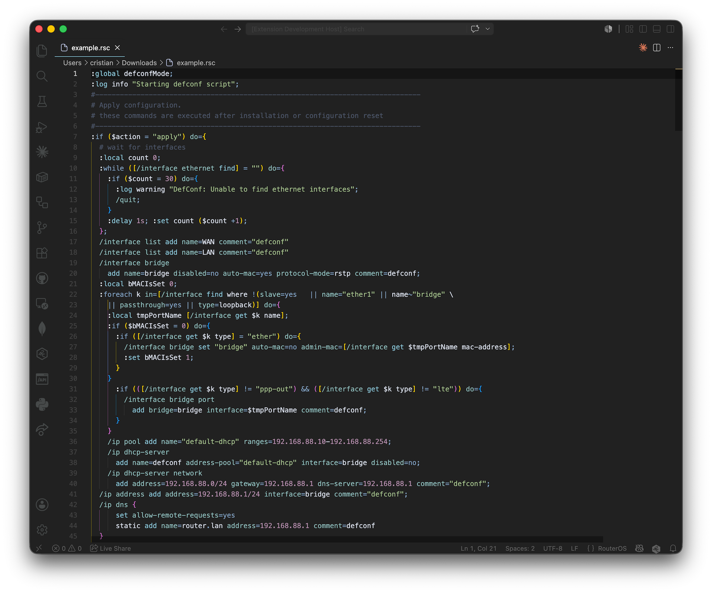

# RouterOS Syntax

Syntax highlighting for [MikroTik RouterOS](https://mikrotik.com) scripts (`.rsc`) in Visual Studio Code.

**[Install from the VS Code Marketplace »](https://marketplace.visualstudio.com/items?itemName=cperezabo.routeros-syntax)**



The grammar is structural: it matches the shape of RouterOS rather than a fixed
list of parameters, so it keeps up with new RouterOS versions without changes.

## Development

### Run locally

Open this folder in VS Code and press **F5** (uses `.vscode/launch.json`): a new
Extension Development Host window opens with the extension loaded. Open a `.rsc`
file there to see the highlighting. The command **Developer: Inspect Editor
Tokens and Scopes** shows which grammar rule produced each token.

All highlighting lives in `syntaxes/routeros.tmLanguage.json`.

### Scripts

```sh
npm run package            # build routeros-syntax.vsix
npm run install-extension  # install that .vsix into your local VS Code
npm run login              # authenticate vsce
npm run publish            # publish to the Marketplace (npm run publish -- minor to bump)
```

`vsce` is fetched via `npx`, never installed — it tracks the Marketplace.

### Releasing

Bump `version` in `package.json`, add a `CHANGELOG.md` entry, and push a tag with
that version (e.g. `2.2.0`): GitHub Actions publishes it to the Marketplace.

---

The grammar was originally derived from the [routeros.tmbundle](https://bitbucket.org/tiktuk/routeros.tmbundle) TextMate bundle.
